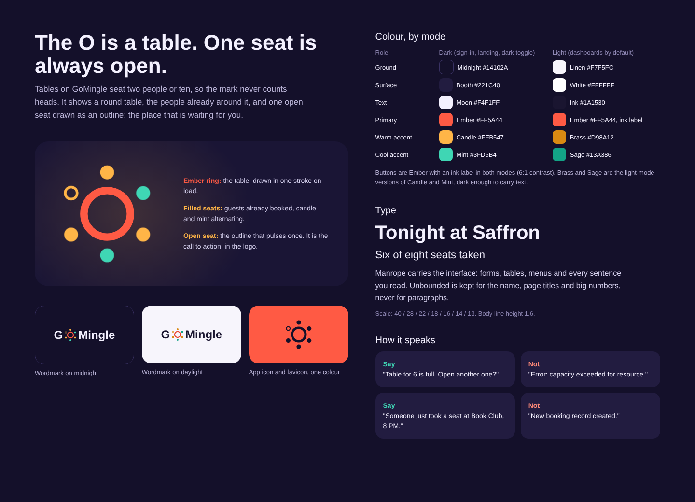
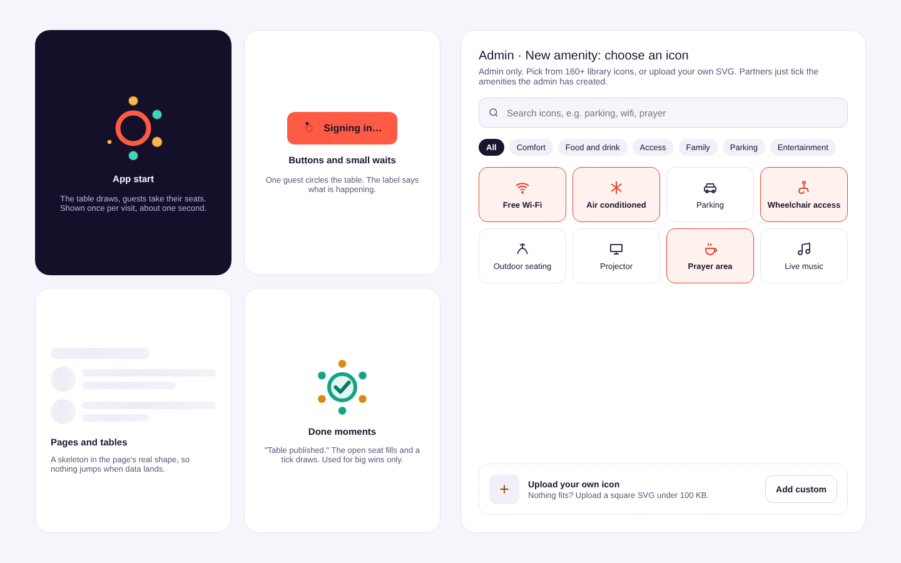
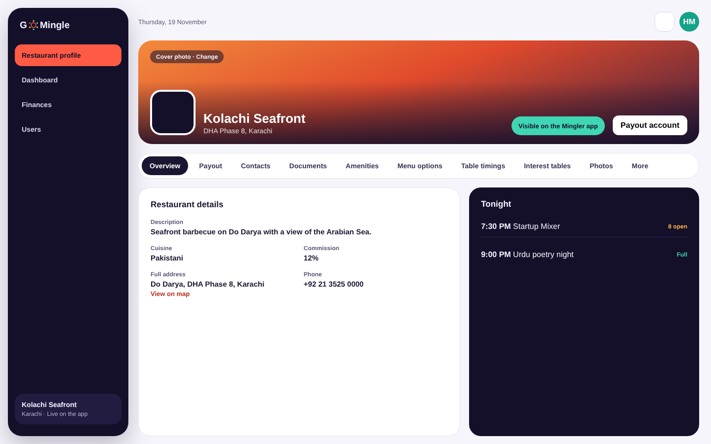
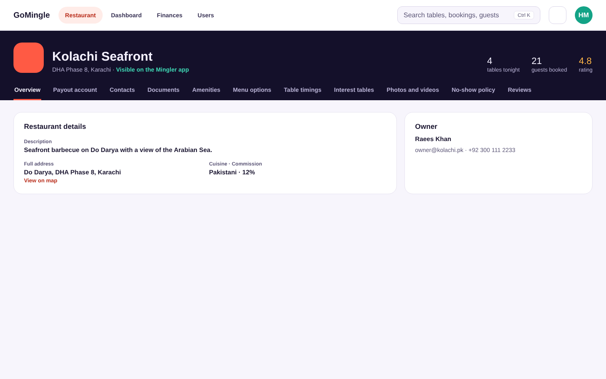
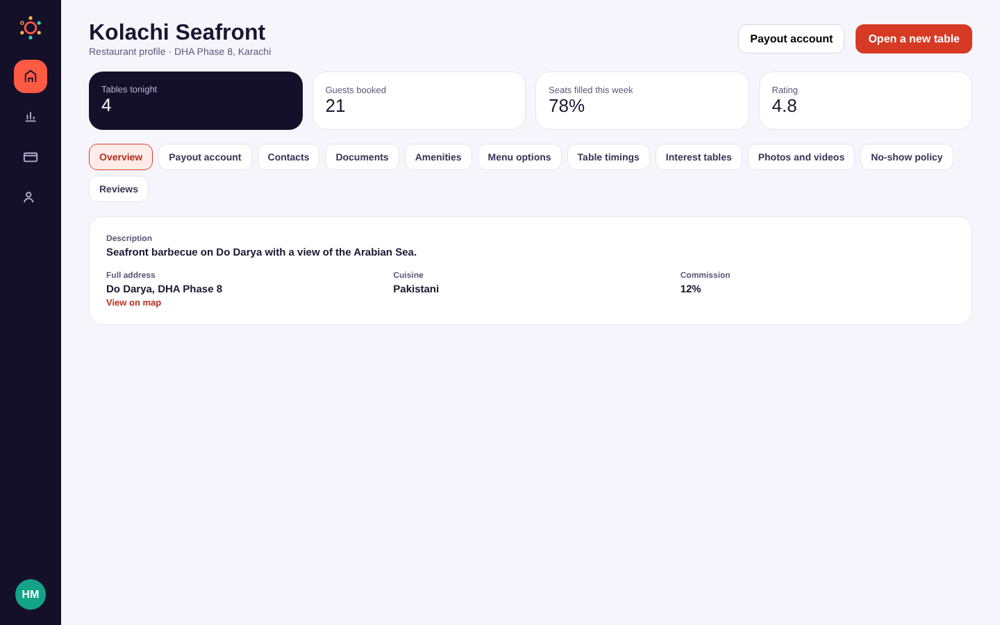
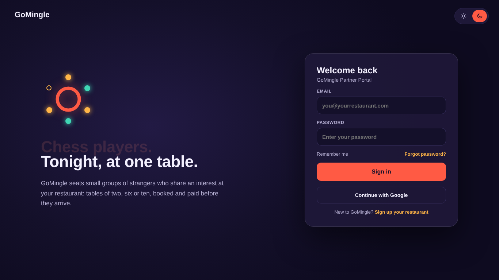
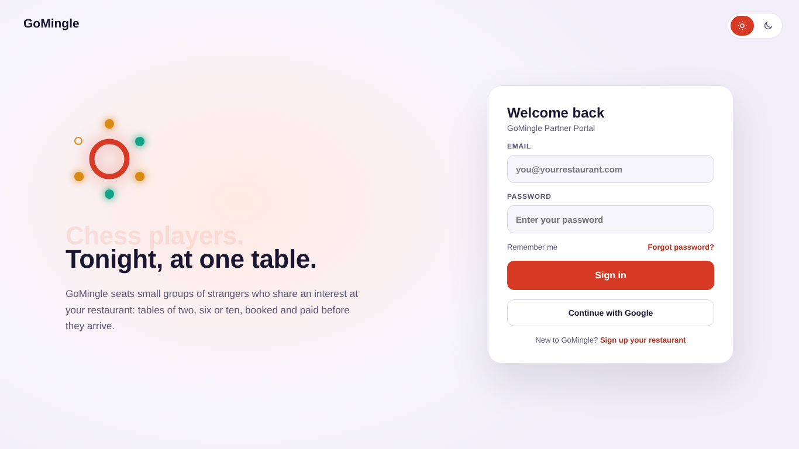
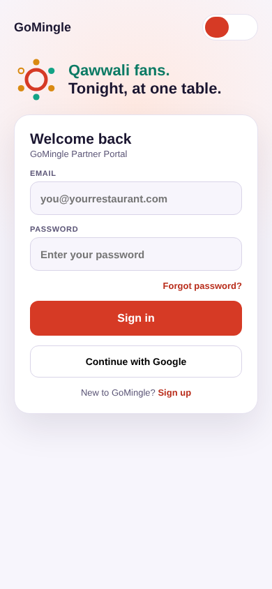
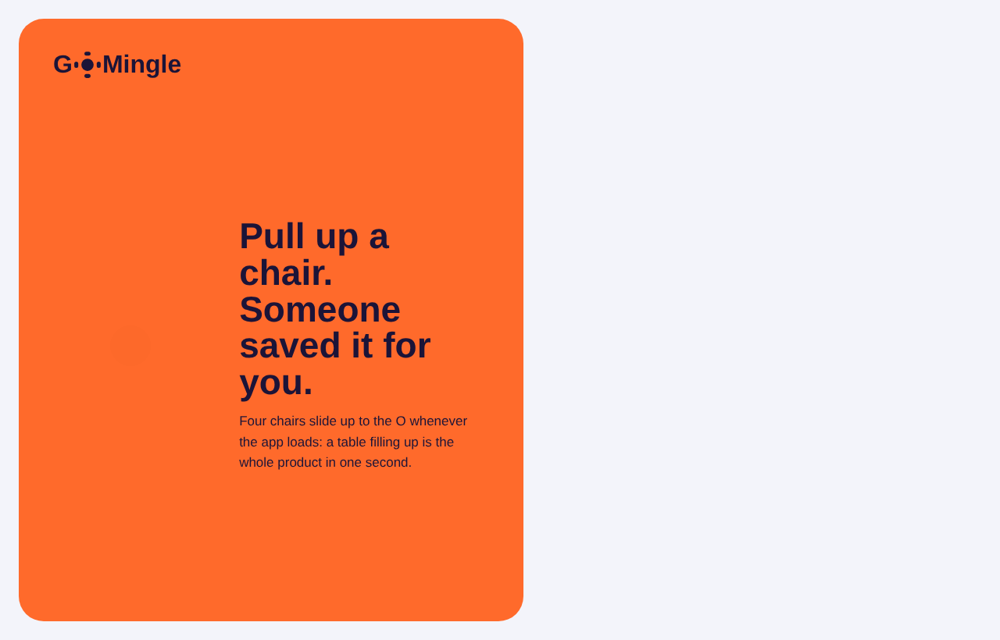
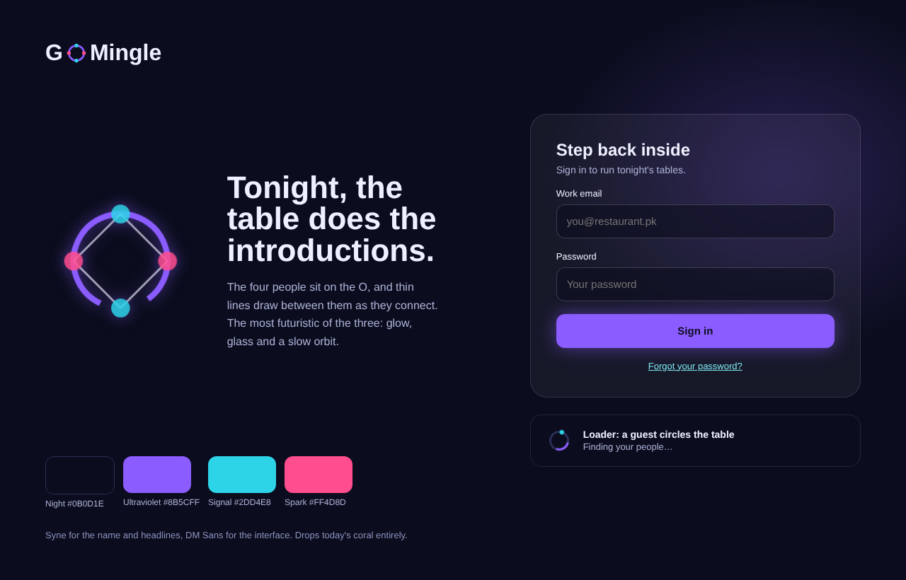

# Admin Panel designs

Designs for the GoMingle Admin Panel, the back office for GoMingle's team. Live: https://gomingle-admin.vercel.app

| Folder | What's in it |
|---|---|
| [`redesign/`](redesign/index.html) | The Candlelit redesign boards (November 2026), exported from the design canvas as standalone pages. Open `redesign/index.html` for the gallery |
| [`screens/`](screens/) | The shipped screens, captured from the current build in light, dark and phone layouts |
| `GoMingle Portals – Admin Dashboard.html` | The first portal mock-up (before the redesign), kept for reference |

## Boards

| Board | |
|---|---|
| [Candlelit - Brand sheet](redesign/main.html) |  |
| [Candlelit - Loaders and motion](redesign/loaders.html) |  |
| [Inside option A - Floating dock](redesign/shell-a.html) |  |
| [Inside option B - Top bar, hero header, Ctrl+K](redesign/shell-b.html) |  |
| [Inside option C - Midnight rail](redesign/shell-c.html) |  |
| [Login option D - Side by side, one screen (dark, 1366×768)](redesign/login-d.html) |  |
| [Login option D - Side by side, one screen (light, 1366×768)](redesign/login-d-light.html) |  |
| [Login option D - Phone (light)](redesign/login-d-phone.html) |  |
| [B - Daylight Social (parked)](redesign/daylight.html) |  |
| [C - Night Market (parked)](redesign/neon.html) |  |

## Shipped screens

Captured on 20 Nov 2026 (v0.13.12) from a production build of the portals running against the API with the E2E sample data (see `Development/E2E/README.md`). Light and dark at 1440×900, phone at 390×844 (full page).

| Screen | Light | Dark | Phone |
|---|---|---|---|
| Sign in | [light](screens/login-light.png) | [dark](screens/login-dark.png) | [phone](screens/login-phone.png) |
| Dashboard | [light](screens/dashboard-light.png) | [dark](screens/dashboard-dark.png) | [phone](screens/dashboard-phone.png) |
| Restaurants | [light](screens/restaurants-light.png) | [dark](screens/restaurants-dark.png) | [phone](screens/restaurants-phone.png) |
| Restaurant detail | [light](screens/restaurants-detail-light.png) | [dark](screens/restaurants-detail-dark.png) | [phone](screens/restaurants-detail-phone.png) |
| Approval queue | [light](screens/approval-queue-light.png) | [dark](screens/approval-queue-dark.png) | [phone](screens/approval-queue-phone.png) |
| Interest tables | [light](screens/interest-tables-light.png) | [dark](screens/interest-tables-dark.png) | [phone](screens/interest-tables-phone.png) |
| Interest table detail | [light](screens/interest-tables-detail-light.png) | [dark](screens/interest-tables-detail-dark.png) | [phone](screens/interest-tables-detail-phone.png) |
| Minglers | [light](screens/minglers-light.png) | [dark](screens/minglers-dark.png) | [phone](screens/minglers-phone.png) |
| Finances | [light](screens/finances-light.png) | [dark](screens/finances-dark.png) | [phone](screens/finances-phone.png) |
| Escrow & payouts | [light](screens/finances-escrow-light.png) | [dark](screens/finances-escrow-dark.png) | [phone](screens/finances-escrow-phone.png) |
| Amenities | [light](screens/amenities-light.png) | [dark](screens/amenities-dark.png) | [phone](screens/amenities-phone.png) |
| Categories | [light](screens/categories-light.png) | [dark](screens/categories-dark.png) | [phone](screens/categories-phone.png) |
| Email templates | [light](screens/email-templates-light.png) | [dark](screens/email-templates-dark.png) | [phone](screens/email-templates-phone.png) |
| Loyalty | [light](screens/loyalty-light.png) | [dark](screens/loyalty-dark.png) | [phone](screens/loyalty-phone.png) |
| Preference questions | [light](screens/preference-questions-light.png) | [dark](screens/preference-questions-dark.png) | [phone](screens/preference-questions-phone.png) |
| Roles & access | [light](screens/roles-access-light.png) | [dark](screens/roles-access-dark.png) | [phone](screens/roles-access-phone.png) |
| Interests | [light](screens/interests-light.png) | [dark](screens/interests-dark.png) | [phone](screens/interests-phone.png) |
| Interest topics | [light](screens/interest-topics-light.png) | [dark](screens/interest-topics-dark.png) | [phone](screens/interest-topics-phone.png) |
| Users | [light](screens/users-light.png) | [dark](screens/users-dark.png) | [phone](screens/users-phone.png) |
| Notifications | [light](screens/notifications-light.png) | [dark](screens/notifications-dark.png) | [phone](screens/notifications-phone.png) |
| Change log | [light](screens/change-log-light.png) | [dark](screens/change-log-dark.png) | [phone](screens/change-log-phone.png) |
| Timer settings | [light](screens/timer-settings-light.png) | [dark](screens/timer-settings-dark.png) | [phone](screens/timer-settings-phone.png) |
| Security | [light](screens/security-light.png) | [dark](screens/security-dark.png) | [phone](screens/security-phone.png) |

The code lives in [`Development/Admin`](../../Development/Admin/README.md).
