# GoMingle – Design Document

System design of GoMingle as built (release **v0.8.0**, live on Vercel), plus the Mingler app as specified in the Requirement Specification (marked *planned*).

Jira: epic **GM-278 Design Document** (one task per diagram). Sprint capacity and velocity: **GM-277**.

Each diagram is kept three ways:
- **`.mmd`**: the source, written in [Mermaid](https://mermaid.js.org). GitHub draws it in the browser, and it can be edited as text.
- **`.svg`**: a sharp picture for documents.
- **`.png`**: a picture at 2× resolution for slides.

To re-draw a picture after editing its source:

```bash
npx -p @mermaid-js/mermaid-cli mmdc -c mermaid-config.json -i 02-erd/erd.mmd -o 02-erd/erd.svg -b white
```

| # | Diagram | Files | What it shows |
|---|---|---|---|
| 1 | Architecture | `01-architecture/` | Clients, the NestJS API on Vercel, Neon PostgreSQL, Safepay, email, Google, and the AWS go-live target |
| 2 | Entity-relationship (ERD) | `02-erd/` | Business entities and how they relate, with cardinality |
| 3 | Database schema | `03-schema/` | All 37 PostgreSQL tables and 329 columns, with types, keys and nullability (full view, plus 4 readable parts) |
| 4 | Class diagram | `04-class/` | NestJS controllers, services, guards and gateways, and their dependencies |
| 5 | Use case | `05-use-case/` | What admins, partners and Minglers can do, and which outside systems take part |
| 6 | Data flow (DFD) | `06-dfd/` | Level 0 (context) and Level 1 (7 processes, 8 data stores) |
| 7 | Flowcharts | `07-flowcharts/` | Partner onboarding, interest table to payout, escrow hold states, sign-in and reset, sending an email |

---

## 1. Architecture

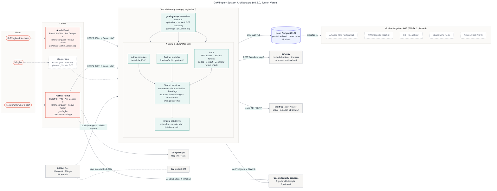

- **Clients**
  - The **Admin Panel** and **Partner Portal** are React 19 single-page apps (Vite, Ant Design 6, TanStack Query, Redux Toolkit), each a Vercel project.
  - The **Mingler app** (Flutter) is planned for Sprints 3–13.
- **API**
  - A **NestJS 11 modular monolith** runs as one Vercel serverless function (`api/index.js` → `dist/serverless.js`).
  - Admin routes live under `/admin/api/v1`, partner routes under `/partner/api/v1/partner`.
  - Each portal has its own JWT audience: 2-hour access tokens and rotating 7-day refresh tokens.
- **Data**
  - **Neon PostgreSQL 17** through **Drizzle ORM**.
  - Migrations run on a cold start, behind a PostgreSQL advisory lock, over the direct connection. Requests use the pooled connection.
- **Integrations**
  - **Safepay**: hosted checkout, capture, void and refund.
  - **Mailtrap** for email now, with any SMTP provider (Brevo, Amazon SES) later.
  - **Google Identity Services** for partner sign-in; the API checks the ID token against Google's public keys.
  - **Google Maps**: a pasted map link sets the restaurant's pin.
- **Delivery**
  - GitHub `Go-Mingle/Go_Mingle` → pull request → `main` → Vercel production.
  - Every change is tracked in Jira project GM.
- **Go-live target (GM-242)**
  - Amazon RDS, Cognito, S3 + CloudFront, ElastiCache and SES/SNS.
  - The SMTP mail provider and the `DATABASE_URL` setting make these drop-in changes.

## 2. Entity-Relationship Diagram (ERD)

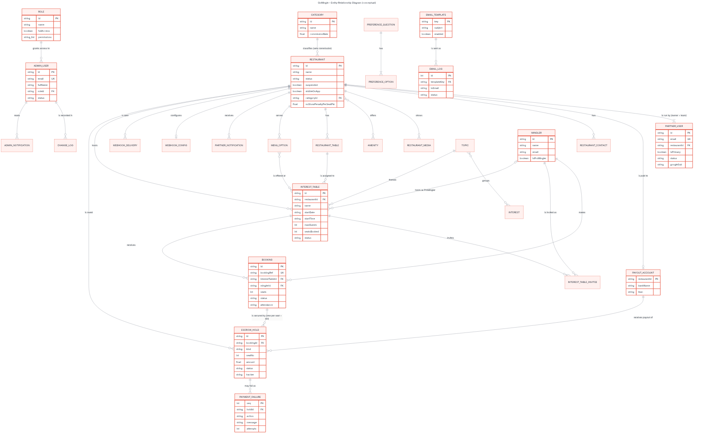

Key rules shown:
- **Restaurants and accounts**
  - A restaurant has **at least one partner user** (its owner) and at most one payout account.
  - Its **category** sets the GoMingle commission.
- **Interest tables**
  - Each belongs to one restaurant, can use one of the restaurant's tables and several of its menu options, and has one topic.
- **Bookings and money**
  - A **booking** is for one interest table. Its money is held in **escrow holds**: one per seat (no-show protection) plus one for the dinner bill.
  - A hold that Safepay refuses becomes a **payment failure**, which an admin retries or closes.
- **Mingler**
  - Today a Mingler is referenced by id and name on bookings and invitees. Its own table arrives with the Mingler app.

## 3. Database schema

Full schema (all tables): `03-schema/schema-full.svg` (best viewed zoomed). The four parts below are easier to read.

**Identity, access and audit**

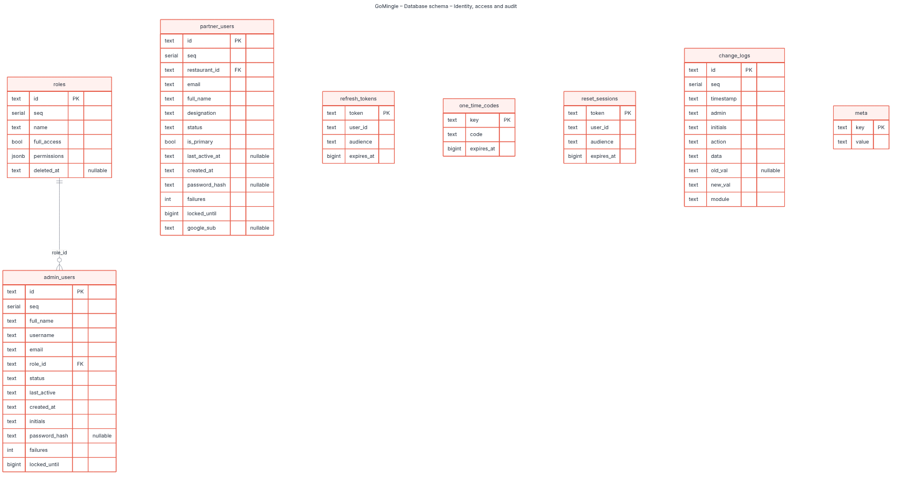

**Restaurants, venue and catalogue**

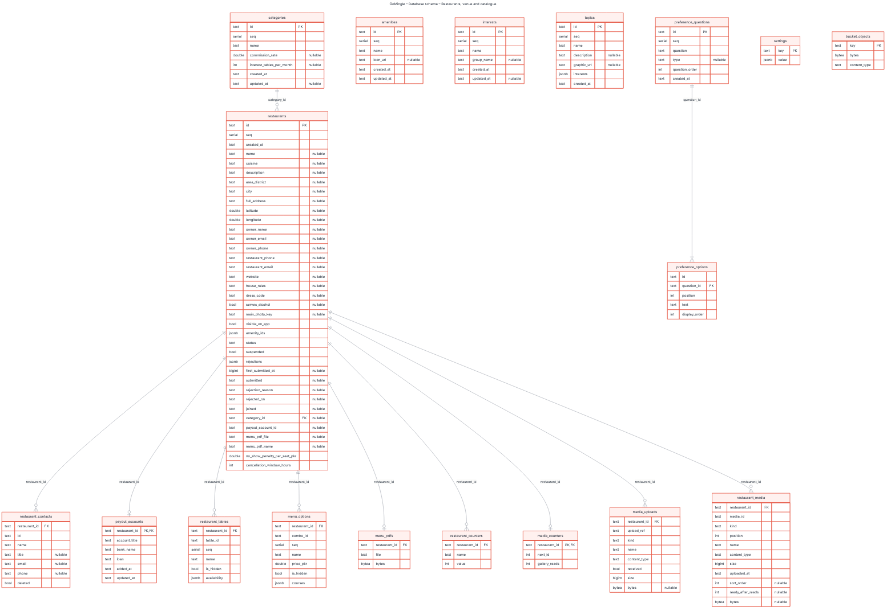

**Interest tables, bookings and payments**

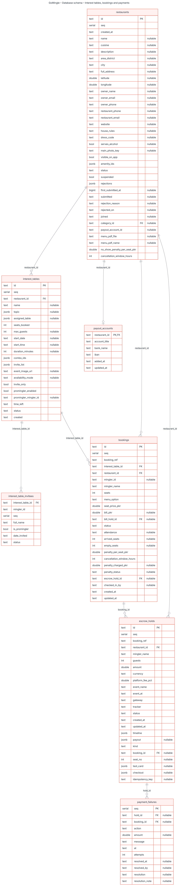

**Notifications, email and webhooks**

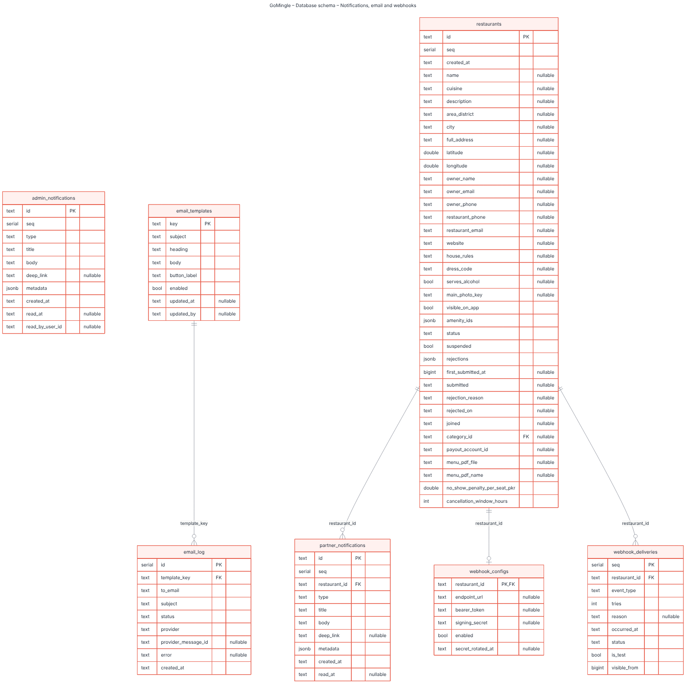

Conventions:
- **Keys:** ids are text (`rest-…`, `pu-…`, `n-…`). A `seq` serial keeps creation order.
- **Times:** times are ISO text; interest table dates and times are **Pakistan time (UTC+05:00)**.
- **Money:** amounts are PKR, stored as `double`.
- **Lists and nested data** use `jsonb`.
- **Source:** `Development/Backend/src/db/schema/*.ts`. Migrations are in `Development/Backend/drizzle/`.

## 4. Class diagram

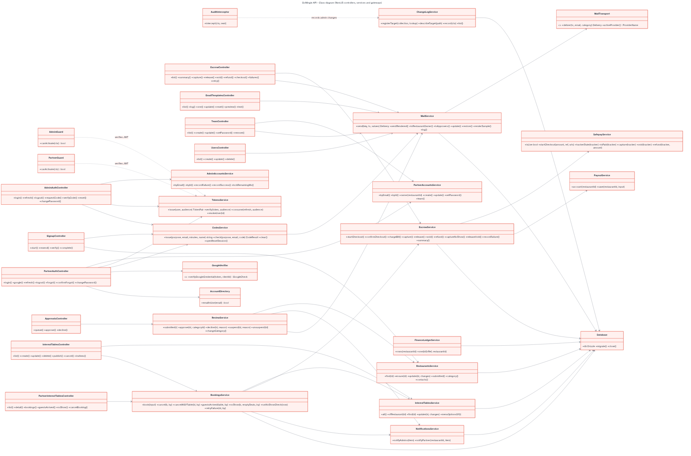

The API is split into four layers:
- **Controllers:** HTTP routes and validation.
- **Guards:** `AdminGuard` and `PartnerGuard` check the JWT and that the account is active. `AuditInterceptor` writes every admin change to the Change Log.
- **Services:** business rules. `BookingsService` covers booking, check-in, no-show and cancellation; `EscrowService` covers holds, capture, release and refund; `MailService` covers templates and delivery.
- **Gateways:** `SafepayService`, the mail transport and the Google verifier.

All data access goes through `Database` (Drizzle).

## 5. Use case diagram

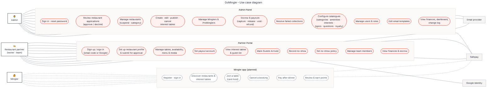

- **Actors:** Admin, Restaurant partner (owner and team) and Mingler (planned).
- **Outside systems:** Safepay, the email provider and Google Identity.
- **Line styles:** dashed use cases belong to the Mingler app, which is not built yet.

## 6. Data Flow Diagrams

**Level 0 – context**

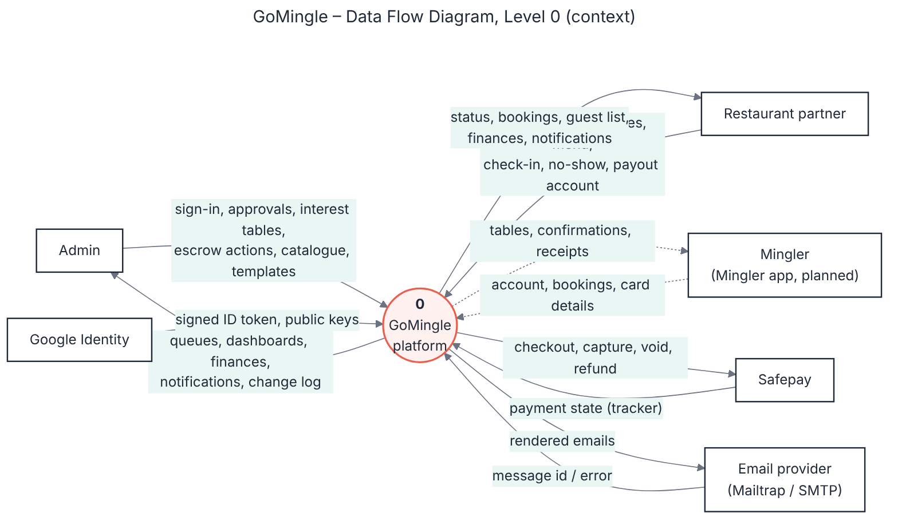

**Level 1**

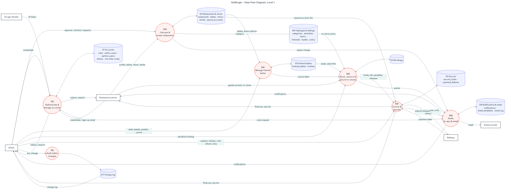

**Processes**

| # | Process |
|---|---|
| 1.0 | Authenticate & manage accounts |
| 2.0 | Onboard & review restaurants |
| 3.0 | Manage interest tables |
| 4.0 | Book, check in & record no-shows |
| 5.0 | Escrow & payouts |
| 6.0 | Notify (in-app & email) |
| 7.0 | Audit admin changes |

**Data stores**

| # | Store |
|---|---|
| D1 | Accounts |
| D2 | Restaurants & venue |
| D3 | Interest tables |
| D4 | Bookings |
| D5 | Escrow |
| D6 | Notifications & email |
| D7 | Change log |
| D8 | Catalogue & settings |

## 7. Flowcharts

**1 – Partner sign-up, profile and approval**

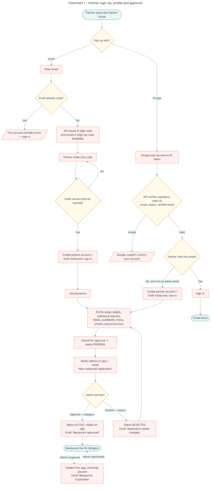

**2 – Interest table, booking, check-in and payout**

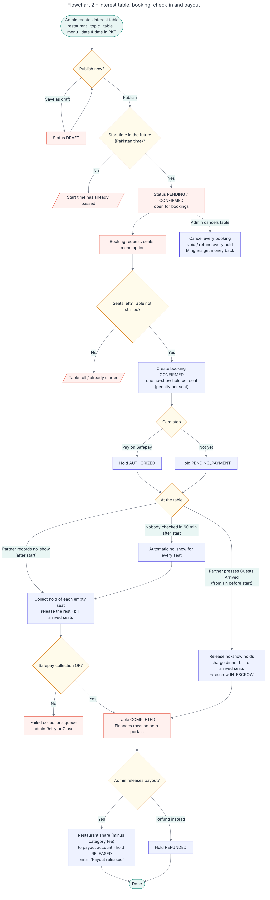

**3 – Escrow hold states**

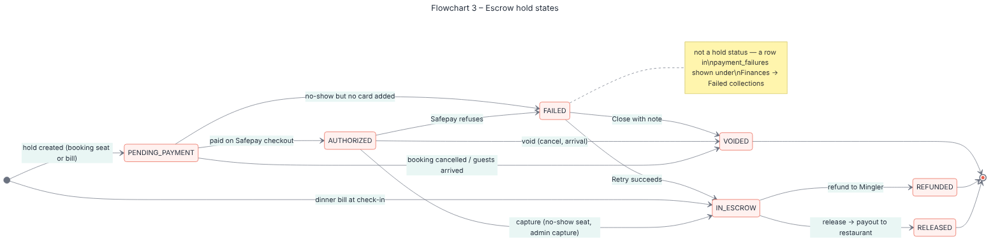

**4 – Sign-in and password reset**

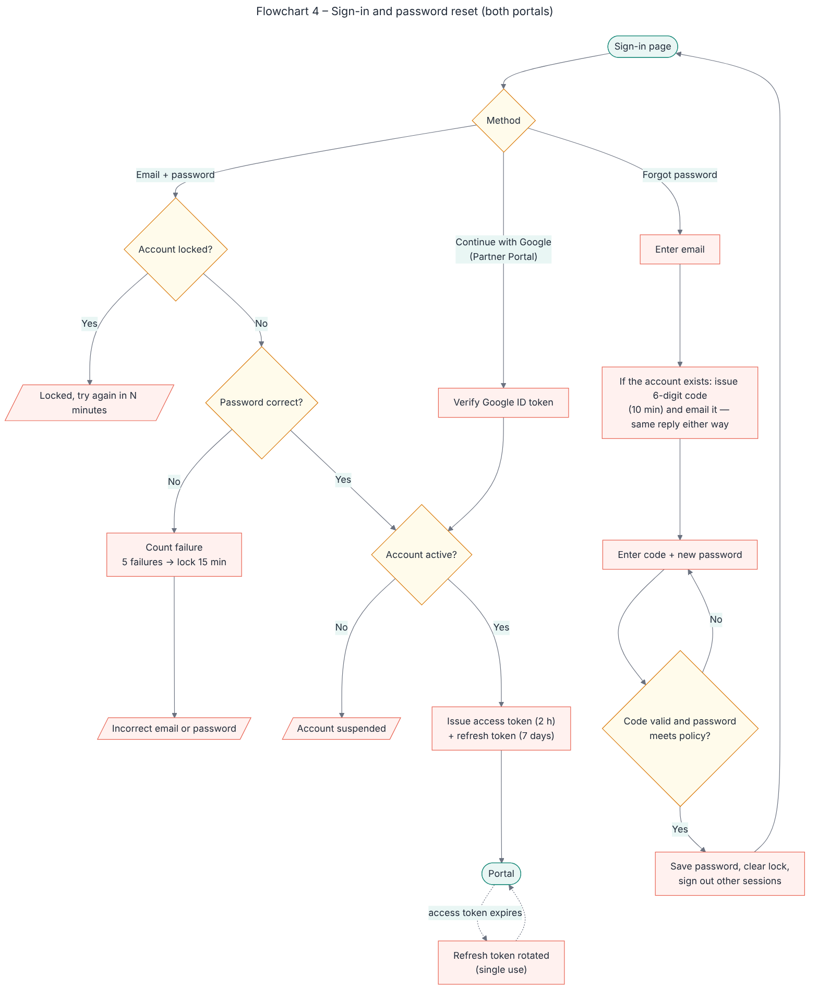

**5 – Sending an email**

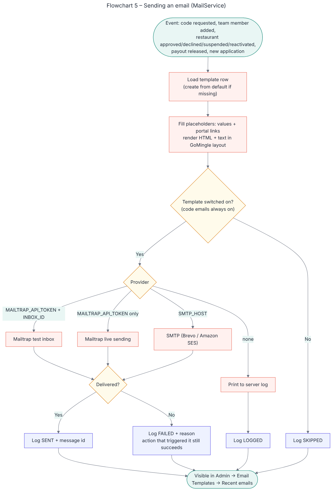

Rules these flowcharts follow:
- **Before a table starts**
  - A table cannot be published, or booked, once its start time has passed.
- **On the day**
  - **Guests Arrived** opens 1 hour before the start.
  - A no-show can be recorded only after the start.
  - If nobody checks in within **60 minutes** of the start, every seat is recorded as a no-show automatically.
- **Cancelling**
  - Cancelling a table cancels all its bookings and gives the Minglers their money back.
- **Sign-in**
  - Five failed sign-ins lock an account for 15 minutes.
  - Codes last 10 minutes.
