# Partner Portal designs

Designs for the GoMingle Partner Portal, where restaurants run their profile, tables and bookings. Live: https://gomingle-partner.vercel.app

| Folder | What's in it |
|---|---|
| [`redesign/`](redesign/index.html) | The Candlelit redesign boards (November 2026), exported from the design canvas as standalone pages. Open `redesign/index.html` for the gallery |
| [`screens/`](screens/) | The shipped screens, captured from the current build in light, dark and phone layouts |
| `GoMingle Portals – Overview.html` | The first portal mock-up (before the redesign), kept for reference |

## Boards

| Board | |
|---|---|
| [Candlelit - Partner sign in (dark)](redesign/login.html) | 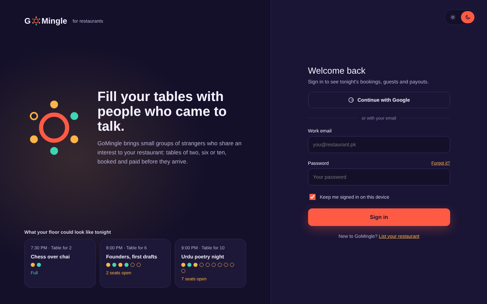 |
| [Candlelit - Partner sign in (light)](redesign/login-light.html) | 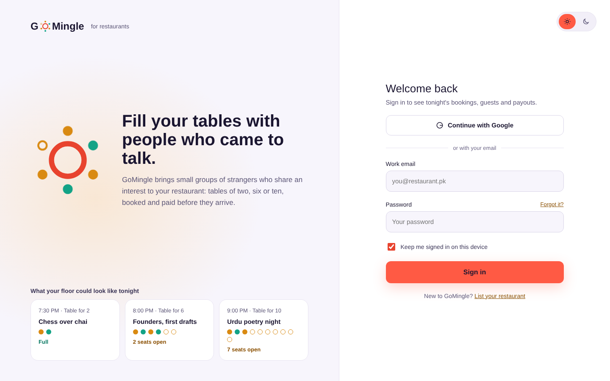 |
| [Candlelit - Partner sign up](redesign/signup.html) | 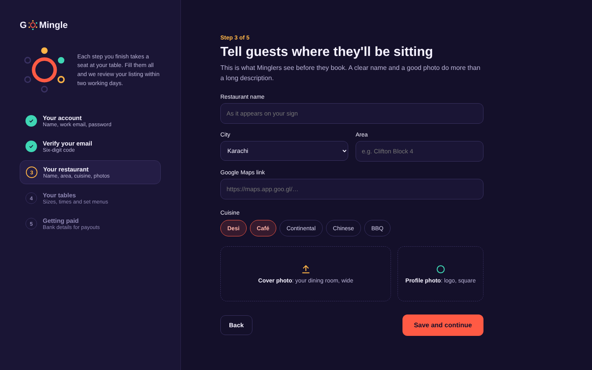 |
| [Candlelit - Dashboard (light)](redesign/dash-light.html) | 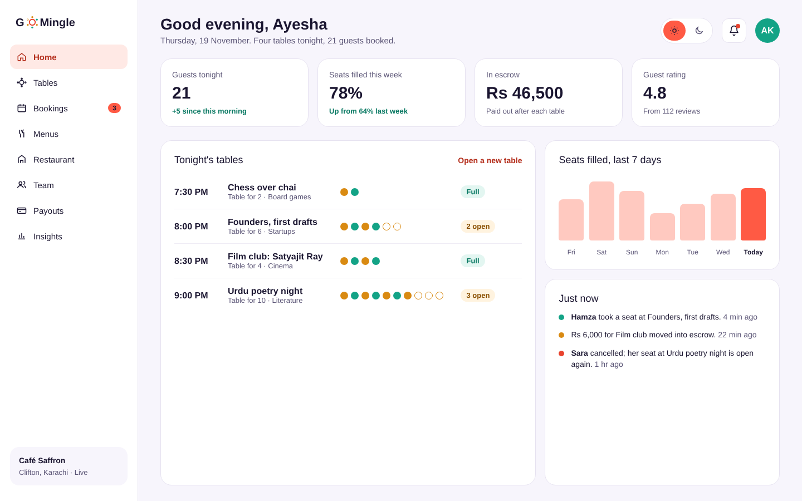 |
| [Candlelit - Dashboard (dark)](redesign/dash-dark.html) | 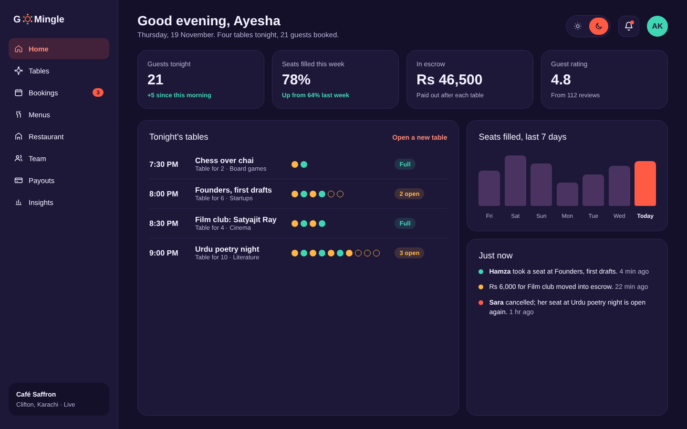 |
| [Login option A - The table is the stage (dark)](redesign/login-a.html) | 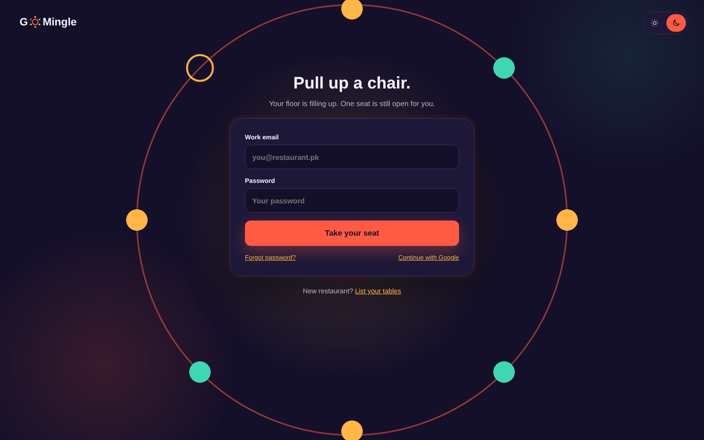 |
| [Login option B - Gathering lights (dark)](redesign/login-b.html) | 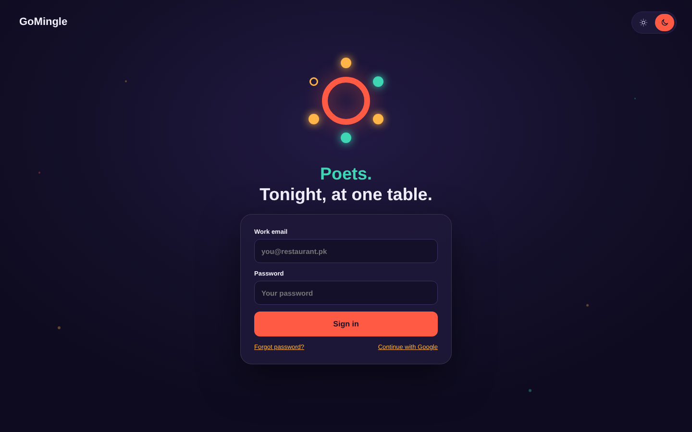 |
| [Login option C - Tonight's floor (light)](redesign/login-c.html) | 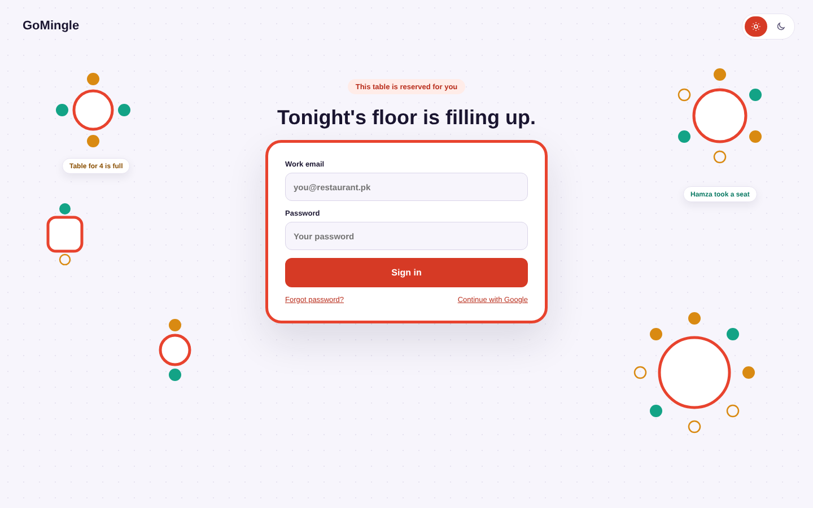 |
| [Login option D - Side by side, one screen (dark, 1366×768)](redesign/login-d.html) | 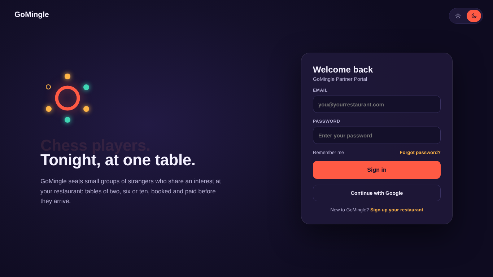 |
| [Login option D - Side by side, one screen (light, 1366×768)](redesign/login-d-light.html) | 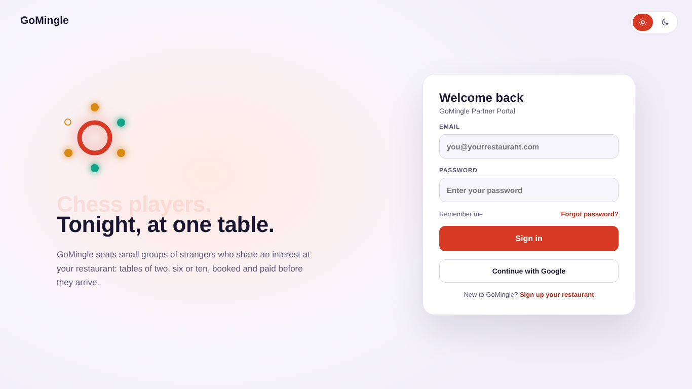 |
| [Login option D - Phone (light)](redesign/login-d-phone.html) | 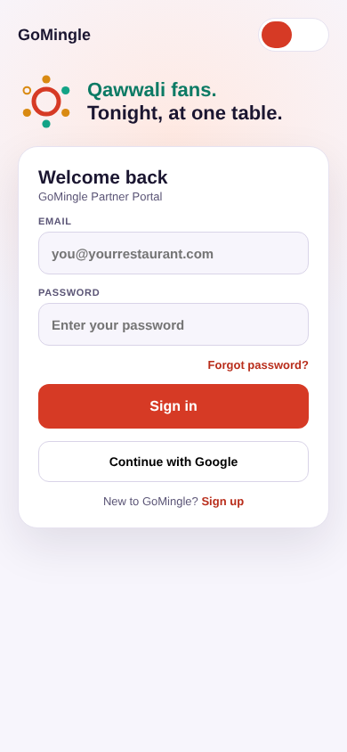 |

## Shipped screens

Captured on 20 Nov 2026 (v0.13.12) from a production build of the portals running against the API with the E2E sample data (see `Development/E2E/README.md`). Light and dark at 1440×900, phone at 390×844 (full page).

| Screen | Light | Dark | Phone |
|---|---|---|---|
| Sign in | [light](screens/login-light.png) | [dark](screens/login-dark.png) | [phone](screens/login-phone.png) |
| Sign up | [light](screens/signup-light.png) | [dark](screens/signup-dark.png) | [phone](screens/signup-phone.png) |
| Restaurant profile | [light](screens/overview-light.png) | [dark](screens/overview-dark.png) | [phone](screens/overview-phone.png) |
| Dashboard | [light](screens/dashboard-light.png) | [dark](screens/dashboard-dark.png) | [phone](screens/dashboard-phone.png) |
| Finances | [light](screens/finances-light.png) | [dark](screens/finances-dark.png) | [phone](screens/finances-phone.png) |
| Users | [light](screens/users-light.png) | [dark](screens/users-dark.png) | [phone](screens/users-phone.png) |
| Notifications | [light](screens/notifications-light.png) | [dark](screens/notifications-dark.png) | [phone](screens/notifications-phone.png) |

The code lives in [`Development/Partner`](../../Development/Partner/README.md).
